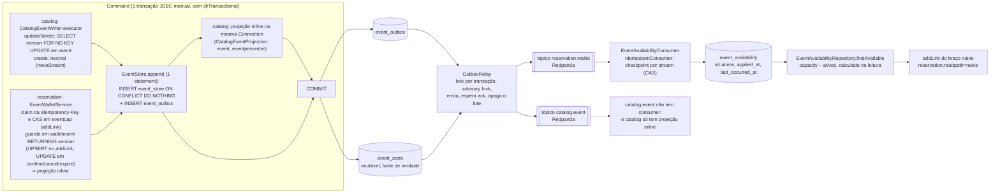
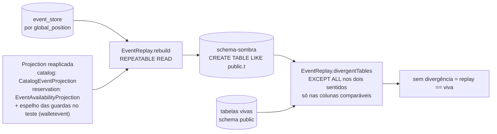

# Fase 6 — CQRS + Event Sourcing no monólito (command, evento, projeção)

Mapa do que a Fase 6 (issues #27–#30) entregou: `catalog` e o lado wallet de `reservation` event-sourced,
**ainda no mesmo processo e no schema `public`**. `eventcap` fica relacional, com o `UPDATE` condicional (CAS).
A decisão e o contrato do evento estão na ADR
[Event Backbone e Event Store](/decisoes-arquitetura/Architecture-Decision-Event-Backbone-Event-Store); os detalhes de código,
em `Projeto/Backend/CLAUDE.md` (seções "Event store e backbone de eventos", "Catalog em CQRS + Event Sourcing" e
"Reservation em event sourcing").

## Command → evento → projeção

Pontos que o desenho fixa:

- **Evento e estado comitam juntos.** Em `catalog` a ordem é `append` e depois a projeção inline; em `reservation` a
  guarda em `walletevent` (que já é a projeção inline) vem antes e o `append` é o último comando antes do commit. Nos dois
  casos tudo está na transação do command; conflito de versão (`append` vazio) é rollback. Em `catalog` o command repete (até 5 tentativas); em `reservation` a versão vem
  da própria guarda, então o conflito não deveria ocorrer e vira a resposta da corrida ("Vínculo já existente").
- **`reservation` é híbrido.** O CAS em `eventcap` continua síncrono e relacional (a tese do TCC); o que vira evento é
  o ciclo da reserva. O braço `naive` também appenda `SlotReserved`, só não toca em `eventcap`.
- **Leituras do contrato HTTP** (`/bff/**`) saem das projeções inline: read-your-writes, `HttpContractTest` sem mudança de
  expectativa. Só o braço `naive` lê a projeção **assíncrona**, e é nela que o lag aparece.
- **`image_data` e a capacidade ficam fora do stream `catalog.event`** (blob; e capacidade é estado de `eventcap`).

## Replay

Em `catalog` a projeção que o command aplica é a mesma que o replay reaplica (`CatalogEventProjection`). Em `reservation`
o `walletevent` vivo é gravado pelas guardas SQL, então o `ReservationReplayTest` reaplica o log com um espelho delas
(mais a `EventAvailabilityProjection`, esta sim a de produção). Nos dois, o teste prova que reconstruir só do log dá o
estado vivo, nas colunas que o log determina (sem carimbos do banco, `image_data` e `applied_at`).

## Evento → quem emite → o que projeta

| Evento | Stream (tópico) | Quem emite | O que projeta |
|---|---|---|---|
| `EventCreated` | `catalog.event` | `EventRepository.save` (via `CatalogEventWriter.executar`) | `event` + `eventpresenter` (inline); `eventcap` nasce na mesma transação |
| `EventUpdated` | `catalog.event` | `EventRepository.update` (via `CatalogEventWriter.executar`) | `event` (metadados, inline) |
| `PresenterAdded` / `PresenterRemoved` | `catalog.event` | `CatalogEventWriter.trocarApresentadores` (um por diferença, na mesma transação do `EventUpdated`) | `eventpresenter` (inline) |
| `EventCancelled` | `catalog.event` | `EventRepository.delete` (via `CatalogEventWriter.executar`) | `DELETE` de `event` (inline; só `eventcap` cai por `CASCADE`; `event_availability` não tem FK desde a #29 e a linha fica órfã, inofensiva porque `findAvailable` parte de `eventcap LEFT JOIN`) |
| `SlotReserved` | `reservation.wallet` | `EventWalletService.addLink` (braços `cas` e `naive`) | `walletevent` pending (inline); `event_availability.ativos` +1 (assíncrona) |
| `ReservationConfirmed` | `reservation.wallet` | `EventWalletService.confirm` | `walletevent` confirmed (inline); `ativos` inalterado, mas `last_occurred_at` e `applied_at` andam |
| `ReservationCancelled` | `reservation.wallet` | `EventWalletService.removeLink` | `walletevent` cancelled (inline); `ativos` −1 |
| `ReservationExpired` | `reservation.wallet` | `ReservationExpiryService` | `walletevent` expired (inline); `ativos` −1 |

## Onde o lag é medido

`occurredAt` (append, na transação do command) → `publishedAt` (header gravado pelo relay) → `applied_at` (commit do
consumer, `clock_timestamp()`).

- `relay_ms = publishedAt − occurredAt` e `consumer_ms = aplicação − publishedAt`, no logger `events.lag` (DEBUG, desligado
  por padrão: um log por evento infla o `consumer_ms`).
- Na linha de `event_availability`: `applied_at − last_occurred_at` = idade do último evento aplicado (é o que o harness de
  carga amostra). Consumer parado não atualiza `applied_at`; olhe também o offset lag do group no Redpanda.
- O Redpanda sobe com `--mode=dev-container` (sem fsync): o `relay_ms` medido é otimista em relação a um disco durável.

## Como o aceite da #30 é provado

| Aceite | Teste |
|---|---|
| Contrato externo inalterado | `HttpContractTest` (sem mudança de expectativa desde a #27) |
| Replay de `catalog` | `CatalogEventSourcingTest.replayDoAgregadoEvent...` |
| Replay de `reservation` (wallet + `ativos`) | `ReservationReplayTest` |
| Replay genérico, snapshot + cauda | `EventReplayTest` |
| Braço `naive` lendo a projeção real (`addLink` → relay → tópico → consumer → `findAvailable`) | `EventAvailabilityProjectionTest.addLinkNaiveRefleteNaDisponibilidadePelaProjecaoReal` |
