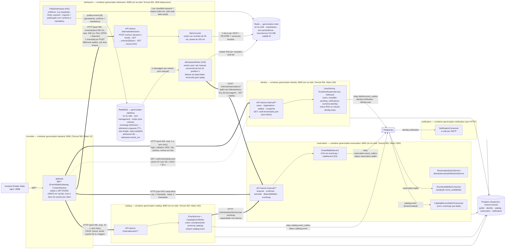
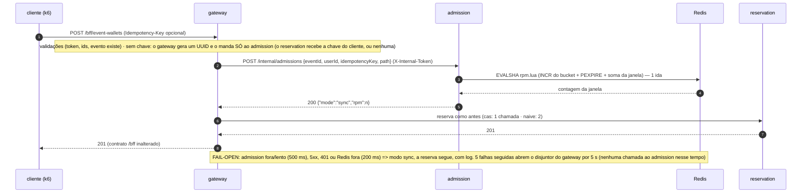
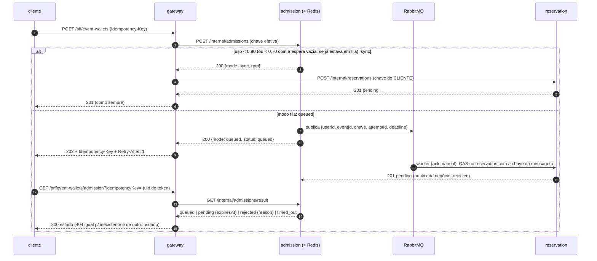
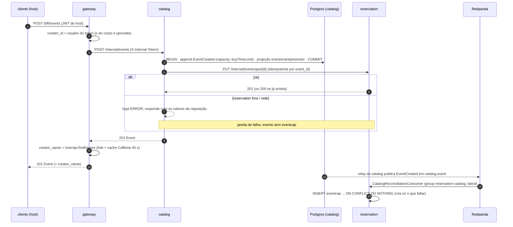
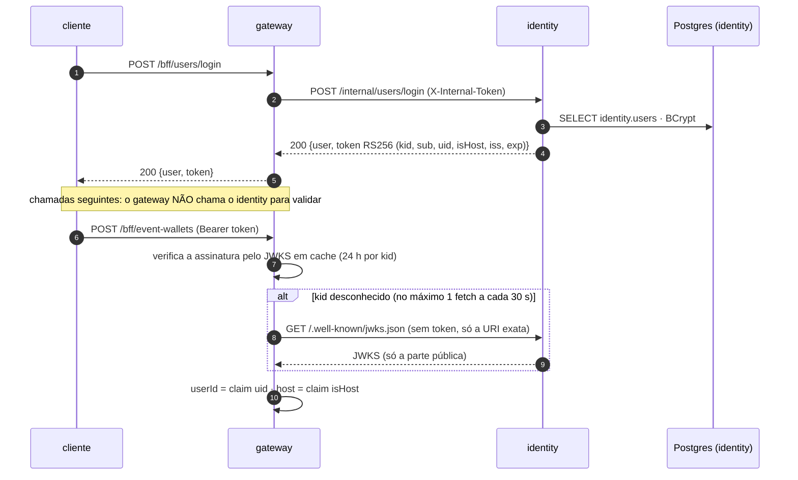
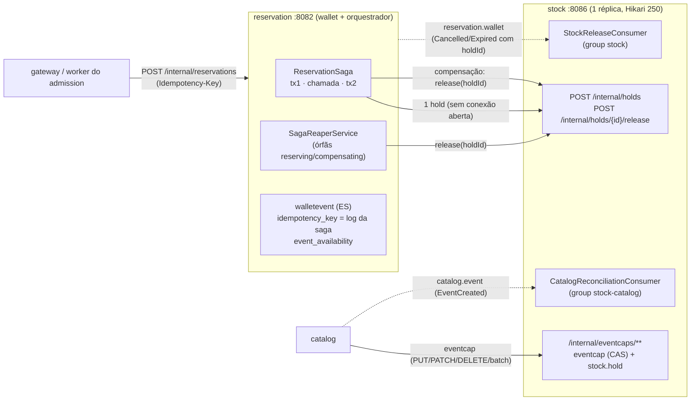

# Fase 7 — serviços extraídos: os saltos `gateway → reservation`, `gateway → catalog` e `gateway → identity`

Mapa do que a Fase 7 entregou até a issue #36: `notification` (#32), `reservation` (#33), `catalog` (#35) e `identity` (#36) saíram do monólito e viraram
**processos, imagens, containers e schemas próprios**. O que sobrou no monólito é só o `gateway` (`/bff/**`, validação do JWT); ele fala com o `reservation`, o
`catalog` e o `identity` **por HTTP** (rede `gerenciador-net`, sem porta no host) e com o `notification` só por evento no backbone; o `catalog` também
chama o `reservation` (capacidade). O diagrama de command → evento → projeção → replay da Fase 6 continua valendo, agora **dentro do
`reservation` e do `catalog`**, cada um com event store próprio:
[`fase6-cqrs-es.md`](/gerenciador-eventos/docs/arquitetura/fase6-cqrs-es). A decisão de separar está na ADR
[Microservices Split](/decisoes-arquitetura/Architecture-Decision-Microservices-Split); o event store por serviço, na ADR
[Event Backbone e Event Store](/decisoes-arquitetura/Architecture-Decision-Event-Backbone-Event-Store). Detalhes de código e configuração em
`Projeto/Backend/CLAUDE.md` ("Serviço reservation", "Serviço catalog", "Serviço identity", "Serviço notification").

> As chamadas `/internal/**` carregam o header `X-Internal-Token` (token de serviço compartilhado, `INTERNAL_API_TOKEN`); sem ele o
> reservation, o catalog e o identity respondem 401 (a única exceção é `GET /.well-known/jwks.json` do identity, só pela URI exata). O
> `identity` assina o JWT (RS256, `kid`, claims `uid` e `isHost`); o `gateway` o valida **sem estado** pelo JWKS em cache (identity fora não
> derruba quem já tem token) e é quem confere o papel de host e o dono do evento, lendo as claims.

> **Issue #41 (Batch 2):** o `admission` (container `gerenciador-admission`, `:8085` só na rede, **sem datasource**) e o Redis (`gerenciador-redis`, só o `admission` o usa) entram no desenho:
> o `gateway` conta cada tentativa de reserva num contador de RPM por evento (ver "O salto de contagem"). O modo é `sync` (desde a #43, `queued` acima do gatilho) e a falha dele é **fail-open**; o `backend` não depende dele.

> **Issue #42 (Batch 2):** o `admission` ganha o **RabbitMQ** (`gerenciador-rabbitmq`, só na rede, sem management, sem volume) e o **worker pool** (ver "A fila de admissão e o worker pool"): a topologia
> (exchange `admission`, fila `admission.requests` com TTL, dead-letter `admission.dlx` → `admission.timed_out`), o caminho de enfileirar, o resultado por mensagem no Redis e o `GET /internal/admissions/result`.
> Na #42 nada disso estava ligado ao `POST /internal/admissions`; a #43 liga (ver "Gatilho e modo fila (#43)"). O `admission` agora chama o `reservation` (depende dele no compose).

## Topologia



## O salto de contagem (#41)



## A fila de admissão e o worker pool (#42)

O gatilho da #43 liga isto ao `POST /internal/admissions` (seção "Gatilho e modo fila (#43)", abaixo). O que existe:

```mermaid
sequenceDiagram
  autonumber
  participant F as FilaDeAdmissao (admission)
  participant X as Redis
  participant Q as RabbitMQ
  participant W as worker (x32, prefetch 1)
  participant R as reservation

  F->>X: Lua: repetição da chave · limite por usuário · queued + espera (attemptId, deadline)
  F->>Q: publica event.{id} (persistente, confirms + mandatory)
  Note over F,Q: nack = fila cheia (429) · returned = sem rota · exceção/bloqueado: desfaz (sync) · sem confirmação em 200 ms = publicada
  Q->>W: entrega (ack manual)
  W->>X: sai da espera; o resultado é desta tentativa e ainda queued?
  W->>R: POST /internal/reservations?path=cas (Idempotency-Key da mensagem)
  alt 201
    W->>X: pending (expiresAt) por compare-and-set · ack
  else 4xx de negócio
    W->>X: rejected (motivo) · ack
  else fora / timeout / 5xx / exceção
    W->>X: volta à espera (ZADD)
    W-->>Q: nack requeue (após o backoff); o TTL original vale
  end
  Q-->>Q: TTL vence: dead-letter → admission.timed_out
  Note over Q,R: o listener da dead-letter chama GET /internal/reservations/replay: achou = pending, senão timed_out (sempre ack)
```

A ordem por evento não é garantida (uma fila só, de propósito: o worker pool é o teto global de CAS simultâneos); a corretude é do CAS. Reiniciar o RabbitMQ (sem volume) perde as mensagens em fila: os `queued`
delas viram `timed_out` depois do `deadline`. Detalhes no `Projeto/Backend/CLAUDE.md`, "Fila de admissão (RabbitMQ) e worker pool — issue #42".

Custo no caminho síncrono: **+1 ida HTTP keep-alive gateway → admission e +1 ida admission → Redis** por reserva (a opção "gateway direto no Redis" seria 1 ida; a spec escolheu o salto ao `admission` porque o modo
do evento, na #43, depende do estado da fila e só o `admission` terá Redis e RabbitMQ). O custo real é medido num mini dry-run (X baixo) e registrado no `Projeto/Backend/CLAUDE.md`.

## Gatilho e modo fila (#43)

Liga a fila da #42 ao `POST /internal/admissions`. **Abaixo do gatilho nada muda** (o gateway segue em 201 com o corpo de sempre). O modo é **por evento**, decidido no mesmo script Lua do contador
(`uso = RPM ÷ (X × réplicas)`, `ADMISSION_X_RPM` 56000, `ADMISSION_RESERVATION_REPLICAS` 1): **uso ≥ 0,80 liga a fila; volta ao síncrono só com uso &lt; 0,70 e a espera do evento vazia** (histerese). Só o braço `cas` enfileira;
o `naive` conta e segue síncrono.



- **A reserva em fila termina no mesmo `pending`** do caminho síncrono; a confirmação segue no `POST /bff/event-wallets/confirm` nos dois modos.
- **Recusas de negócio** do `admission` são repassadas pelo gateway: 422 (chave de outro evento) e 429 (limite de 5 mensagens em espera por usuário, fila cheia). Mensagem não publicada (broker bloqueado, sem rota) = `sync`.
- **Chave no `reservation`:** com o `admission` respondendo `sync`, a do cliente (nula se não mandou), como antes; **só no fail-open do `cas`** (chamada ao `admission` falhou) a chave efetiva (a do cliente ou a gerada): o
  `admission` pode ter publicado antes de o gateway desistir, e o `reservation` deduplica pela chave.
- **Consulta** (`GET /bff/event-wallets/admission`): fora do disjuntor do `admit`; `admission` fora = 503 genérico.
- **Janela de falha:** a decisão do modo (script do contador) e a entrada da mensagem na espera (`enfileirar.lua`) são duas idas ao Redis, não atômicas entre si (só no modo fila). Três consequências, nenhuma com estado preso nem efeito na corretude (o CAS
  guarda; o `reservation` deduplica pela chave): (1) outro pedido com uso &lt; 0,70 e espera vazia pode desligar o modo entre as duas; o `enfileirar.lua` o religa, então o evento fica em fila **sem uso ≥ 0,80** e, se o uso ficar entre 0,70 e 0,80, segue em fila até
  a 1ª decisão com uso &lt; 0,70 e espera vazia; (2) se a publicação falha (entrada desfeita, resposta `sync`), o modo marcado pelo `enfileirar.lua` fica ligado com a espera vazia, com a mesma saída; (3) o requeue do worker (`voltar.lua`) também religa o modo (o worker segurava a
  mensagem, a espera esvaziou e uma decisão pode tê-lo desligado), mantendo "mensagem esperando = modo fila".

## O salto no braço `cas` e no braço `naive`

```mermaid
sequenceDiagram
  autonumber
  participant C as cliente (k6)
  participant G as gateway (monólito)
  participant R as reservation
  participant P as Postgres

  Note over C,P: braço cas (RESERVATION_READPATH=cas) — UMA chamada, CAS atômico no reservation
  C->>G: POST /bff/event-wallets (Idempotency-Key)
  Note over G: uid vem do claim do token (sem consulta; a carteira nasce com o usuário e o gateway deixou de conferi-la, #36)
  Note over G: evento existe? desde a #35, GET /internal/events/{id}/exists no catalog (positivo em cache 30 s; catalog fora = 503)
  G->>R: POST /internal/reservations?path=cas
  R->>P: SELECT eventcap, existsActive
  R->>P: BEGIN · claim da chave · UPDATE eventcap (CAS) · UPSERT walletevent · append SlotReserved · COMMIT
  R-->>G: 201 pending (+ header Idempotency-Key)
  G-->>C: 201

  Note over C,P: braço naive (RESERVATION_READPATH=naive) — DUAS chamadas; a janela check-then-act inclui a rede
  C->>G: POST /bff/event-wallets
  Note over G: uid do claim · evento existe? (catalog, como acima)
  G->>R: GET /internal/events/{id}/availability
  R->>P: eventcap LEFT JOIN event_availability (projeção defasada)
  R-->>G: {"available": n}
  alt n == 0
    G-->>C: 400 Evento lotado (sem a 2ª chamada)
  else n > 0 ou -1
    G->>R: POST /internal/reservations?path=naive
    R->>P: BEGIN · claim da chave · UPSERT walletevent (SEM CAS) · append SlotReserved · COMMIT
    R-->>G: 201 pending
    G-->>C: 201
  end
```

## Criação do evento: `eventcap` por chamada síncrona + reconciliação



O `creator_name` é **composto no `gateway`** (consulta em lote ao `identity` + cache), não projetado no `catalog`: o `catalog` só guarda o
`creator_id` (integer, referência solta, sem FK). Conta desativada = `creator_name` nulo. O dono (`creator_id` do evento == usuário do token)
é exigido pelo gateway em PUT, DELETE e upload de imagem (403).

## O que cada serviço enxerga

| | `monolito` (gateway) | `identity` | `catalog` | `reservation` | `notification` |
|---|---|---|---|---|---|
| `users`, `mywallet`, `pending_verifications` | — | lê e escreve (schema `identity`) | — | — | — |
| `event`, `eventpresenter` | — | — | lê e escreve | — | — |
| `eventcap`, `walletevent`, `idempotency_key`, `event_availability` | — | — | — | lê e escreve | — |
| event store (`event_store`, `event_outbox`, `projection_checkpoint`, `event_snapshot`) | — (o `public` ficou só com a infra da lib `shared`) | o do serviço: `identity.notification` (congelado) e `identity.user` | o do serviço: `catalog.event` | o do serviço: `reservation.wallet` | — |
| `processed_event` | — | — | — | — | lê e escreve |

Nenhum serviço lê tabela de outro e **não há FK cross-schema** (nem nas tabelas do `reservation`; `mywallet` mora no schema `identity` com
`users` justamente porque a FK e o trigger 1:1 entre as duas só cabem no mesmo schema). O que as FKs garantiam virou chamada ou claim:
o gateway confere o evento (no `catalog`) antes de reservar e o criador no `identity`; o `uid` do usuário vem **assinado no token** (nenhuma
consulta ao `identity` por reserva) e a carteira nasce no mesmo `INSERT` do usuário; o catalog remove o `eventcap` por HTTP
(409 se há reserva do evento, o antigo `RESTRICT`).

## Login, JWT e validação sem estado (#36)



Consequências do desenho sem estado: desativar a conta, trocar a senha ou mudar `host` só valem para tokens **novos** (um token emitido
segue válido até `exp`, 10 h por padrão); um `uid` que não existe mais não dá 401 em `event-wallets`. A chave RSA é gerada no 1º boot do
`identity` e fica no volume `identity-keys` (sobrevive a restart/rebuild; `down -v` a apaga e todo token antigo vira 401). Limpar o banco
com `TRUNCATE ... RESTART IDENTITY` recicla o `user_id`: por isso a limpeza entre blocos da carga e o `run-tests.sh` apagam a chave, e o
`backend` (cache de JWKS de até 24 h) tem de ser reiniciado depois do identity.

## Saga `stock` + `wallet`: o salto `reservation → stock` (#47)

O `reservation` foi dividido em `stock` (o `eventcap`/CAS, o ledger `stock.hold` e `/internal/eventcaps/**`; uma réplica fixa, `:8086`) e o próprio `reservation` (lado *wallet*, `walletevent` em ES, e o **orquestrador** da reserva).
O gateway, o worker do `admission` e o `lb:8082` continuam falando só com o `reservation`.



Sequência da reserva (o `wallet` nunca segura conexão nem transação durante a chamada ao `stock`; o Supavisor está em transaction mode):

```mermaid
sequenceDiagram
  participant C as gateway / worker
  participant W as reservation
  participant S as stock
  C->>W: POST /internal/reservations?path=cas
  W->>W: tx1: INSERT idempotency_key (hold_id, reserving) COMMIT
  W->>S: POST /internal/holds {holdId, mode}
  S->>S: tx: INSERT hold, CAS (último comando) COMMIT
  S-->>W: 201 | 400 lotado/janela/sem capacidade | 409 lápide
  W->>W: tx2: reserving -> reserved (CAS por hold_id), reservePending, SlotReserved{holdId} COMMIT
  W-->>C: 201 pending (400 apaga a linha; 409/5xx/timeout -> compensação inline)
```

Cancelar e expirar não chamam o `stock`: o `wallet` appenda `ReservationCancelled`/`ReservationExpired` com o `holdId` (no outbox) e o `StockReleaseConsumer` libera o hold e devolve a vaga (idempotente por `holdId`).
Uma saga órfã (processo morto entre o hold e a tx2, ou `release` que não chegou ao `stock`) é resolvida pelo reaper em até `ORPHAN_MS + SCAN_MS` (~35 s com os defaults).

## Janelas de falha (sem atomicidade distribuída)

- **Evento criado, `eventcap` não**: a chamada síncrona falhou. A criação responde normalmente; o `EventCreated` do tópico faz o
  `stock` (desde a #47; antes o `reservation`) criar o que faltou quando voltar (reservar nesse intervalo: "Capacidade do evento não configurada").
- **Capacidade removida, evento mantido**: o `reservation` apagou o `eventcap` (cancelamento) e o commit do catalog falhou depois. Raro; o
  evento fica sem `eventcap`.
- **RabbitMQ fora** (#42): a publicação falha (conexão recusada em 2 s) e o caminho de enfileirar desfaz a entrada e devolve "não publicada" (desde a #43 o `admission` responde `sync` e o gateway segue síncrono); o worker reconecta sozinho. **Reservation fora**:
  o worker devolve a mensagem à fila com backoff (nada se perde enquanto o TTL de 30 s não vence; depois, dead-letter e `timed_out`).
- **`admission` ou Redis fora** (#41): **fail-open**. O gateway segue reservando pelo caminho de hoje (a contagem do evento só perde essas tentativas); o `AdmissionClient` loga com limite de taxa (1 linha a cada 10 s)
  e, depois de 5 falhas seguidas, deixa de chamar o `admission` por 5 s (disjuntor). Token interno diferente nos dois lados (401) também é fail-open, mas logado em ERROR. O `backend` não depende do `admission`
  no compose. Redis lento/fora dentro do `admission`: timeout de 200 ms, comandos rejeitados na hora e resposta **503** (que o disjuntor do gateway conta; um 200 `sync` esconderia o Redis travado e cada reserva pagaria os 200 ms).
- **`reservation` fora**: reservar, confirmar, cancelar, listar inscrições, **ler/listar/buscar eventos** (a resposta de `Event` leva a
  capacidade, que vem do serviço) e **apagar evento** (a remoção do `eventcap` vem antes da transação do catalog, que então nem começa)
  falham com erro de rede; login e cadastro seguem. Criar evento não falha (ver a primeira janela).
- **`catalog` fora** (#35): ler/listar/buscar/criar/editar/apagar evento e **reservar** respondem **503** genérico no gateway (a conferência
  do evento na reserva nunca vira "Evento não encontrado"; um positivo de `exists` ainda no cache de 30 s deixa a reserva seguir). Criar
  evento com o catalog lento responde 503 "resultado incerto, confira em Meus eventos" (o timeout de 15 s pode vencer depois do commit).
  Login, cadastro, carteira e "minhas reservas" seguem.
- **`identity` fora** (#36): login, cadastro (request-verification, verify-email, resend), MFA, troca de senha, `/bff/users/**` (inclusive `/me`) e
  `/bff/my-wallets/**` respondem **503** genérico (nunca 401 nem 500; o 401 com `INTERNAL_API_TOKEN` errado no identity também vira 503). Quem já tem
  token válido **segue reservando e lendo eventos**: o gateway valida pelo JWKS em cache (24 h, tolerante a queda) e lê `uid`/`isHost` do token.
  Com o cache de JWKS vazio (backend recém-subido, identity fora) o token não valida: rota protegida dá 401, rota pública segue anônima. Os
  pedidos de e-mail que o identity ainda não publicou ficam no `identity.event_outbox` e saem quando ele volta. O `creator_name` fica nulo.
- **Editar evento com o `reservation` fora** (#60): o `PATCH` da capacidade roda ANTES da transação do catalog; se falha (serviço fora, 400, 409),
  **nada é gravado no catalog** (nem metadados nem apresentadores) e a edição inteira falha. Metadados e apresentadores entram numa única
  transação do catalog. Janela restante: o reservation atualizou e a transação do catalog falhou (capacidade nova, metadados antigos; repetir o
  PUT converge). O `PATCH` num evento SEM `eventcap` responde 404 e o catalog o cria com os valores novos, em vez de perder a edição para a
  reconciliação.
- **Apagar evento**: o catalog chama `DELETE /internal/eventcaps/{id}` ANTES da transação (sem segurar conexão nem lock durante o salto de
  rede; o 409 de evento com reserva acontece antes de qualquer escrita). Se o reservation apagou a capacidade e a transação do catalog falha em
  seguida, o evento fica sem `eventcap`.

Janelas da saga `stock` + `wallet` (#47; detalhes e testes na spec `docs/superpowers/specs/2026-10-29-saga-stock-wallet-design.md`):

- **`stock` fora** (conexão recusada): o `POST` interno responde 503 (500 genérico no `/bff`; o worker do `admission` faz backoff e requeue), a saga fica `compensating` (o `release` também falhou) e o `quant` fica intacto. O reaper a fecha no primeiro tick depois da volta
  (tempo ilimitado com o `stock` fora, mas seguro: vaga presa, sem overselling). Cancelar e expirar seguem respondendo; as devoluções esperam no tópico.
- **`stock` comitou e a resposta se perdeu (timeout)**: compensação inline (`release(holdId)` devolve a vaga e responde 503); repetir a chave reabre com hold novo. Um "reservar" atrasado do mesmo `holdId` chega depois e dá 409 (lápide), sem débito.
- **`reservation` cai entre o hold e a tx2**: saga `reserving` órfã; o reaper (outra réplica, ou a mesma ao voltar) compensa depois de `ORPHAN_MS`. Dono lento que passa de `ORPHAN_MS` perde o CAS da tx2 e responde 503; o reaper libera.
- **Desfecho incerto da tx2** (exceção, inclusive no `commit()`): não compensa inline, responde 503 e deixa para o reaper; se a tx2 comitou, a linha está `reserved` e ninguém a toca.
- **Redpanda fora**: o relay acumula no outbox e as devoluções por evento atrasam (venda a menos, nunca a mais).
- **`stock` fora na criação/edição/remoção de evento**: como era com o `reservation` fora, agora com o `stock` (reconciliação pelo `EventCreated`, group `stock-catalog`). O `catalog` não depende do `stock` no boot.
